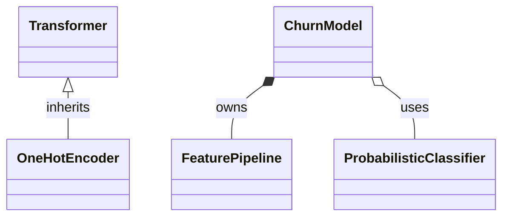

# OOP and software engineering cheat sheet

The syntax from the workshop on one page, with pointers to the notebook that explains it.

## Classes and objects (01)

```python
class ConfusionMatrix:
    model_family = "binary"              # class attribute: shared by all instances

    def __init__(self, tn: int, fp: int, fn: int, tp: int) -> None:
        self.tn, self.fp, self.fn, self.tp = tn, fp, fn, tp   # instance attributes

    def recall(self) -> float:           # method: first parameter is always self
        return self.tp / (self.tp + self.fn)

    @property
    def n(self) -> int:                  # computed attribute: cm.n, no parentheses
        return self.tn + self.fp + self.fn + self.tp

    @classmethod
    def from_predictions(cls, y_true, y_pred) -> "ConfusionMatrix":   # alternative constructor
        ...

    @staticmethod
    def safe_div(a: float, b: float) -> float:   # plain function that lives in the class
        return a / b if b else 0.0


cm = ConfusionMatrix(tn=50, fp=10, fn=5, tp=35)   # an instance (object)
cm.recall()
```

Do not use a mutable value (list, dict) as a class attribute or default argument unless you want it shared.

## Inheritance (02)

```python
class BaselineModel:
    def evaluate(self, X, y): ...        # written once, inherited by every subclass

class TenureRuleModel(BaselineModel):    # TenureRuleModel "is a" BaselineModel
    def __init__(self, max_tenure: int = 12) -> None:
        super().__init__()               # run the parent's __init__ first
        self.max_tenure = max_tenure

    def predict(self, X):                # override: replaces the parent's version
        return (X["tenure"] < self.max_tenure).astype(int)

isinstance(TenureRuleModel(), BaselineModel)   # True
TenureRuleModel.__mro__                         # order in which Python searches for methods
```

Inherit only if the "is a" sentence is true and you want the whole parent interface. Otherwise hold the other object as an attribute (composition, 08).

## Special methods (03)

| You write | Python calls |
| --- | --- |
| `repr(x)`, notebook display | `x.__repr__()` |
| `str(x)`, `print(x)` | `x.__str__()` |
| `len(x)` | `x.__len__()` |
| `x[i]` | `x.__getitem__(i)` |
| `for v in x`, `a, b = x` | `x.__iter__()` |
| `v in x` | `x.__contains__(v)` |
| `x == y` | `x.__eq__(y)` (defining it removes `__hash__`) |
| `x + y` / `0 + x` (in `sum()`) | `x.__add__(y)` / `x.__radd__(0)` |
| `x(a, b)` | `x.__call__(a, b)` |
| `with x as v:` | `x.__enter__()`, then `x.__exit__(...)` |

Return `NotImplemented` (not `False`, not an exception) from binary operators when the other object is of an unsupported type.

## Encapsulation and abstraction (04)

```python
from abc import ABC, abstractmethod

class Transformer(ABC):
    @abstractmethod
    def fit(self, X): ...
    @abstractmethod
    def transform(self, X): ...
    def fit_transform(self, X):          # concrete method built on the abstract ones
        return self.fit(X).transform(X)

class OneHotEncoder(Transformer):
    def __init__(self, columns):
        self.columns = columns           # public: part of the interface
        self._categories = {}            # internal: may change without notice

    @property
    def categories(self):                # read-only view, returns a copy
        return {k: list(v) for k, v in self._categories.items()}
```

- `_name` is a convention ("internal, do not rely on it"), not access control. `__name` only renames the attribute.
- Learn parameters in `fit` on training data; `transform` only applies them. Never fit on the batch you are scoring.
- A property with a setter can validate: `@threshold.setter`.

## Polymorphism, duck typing, protocols (05)

```python
from typing import Protocol, runtime_checkable

@runtime_checkable
class Predictor(Protocol):
    def fit(self, X, y): ...
    def predict(self, X): ...

def leaderboard(models: dict[str, Predictor], X, y): ...   # works for any object with fit/predict
```

| Use an ABC when | Use a Protocol when |
| --- | --- |
| you own the hierarchy and want to share code | you describe what you need from objects you do not control |
| missing methods should fail at instantiation | structural compatibility is enough |

`isinstance(obj, Predictor)` with `@runtime_checkable` only checks that the methods exist, not their signatures.

## Reading unfamiliar code (06)

Start from the public API, look at `__init__` and the main method (`fit`, `run`), follow the base classes (`inspect.getmro(cls)`), print source with `inspect.getsource(obj)`, and use "Go to definition" (F12 in VS Code).

## Type hints, docstrings, dataclasses (07)

```python
from dataclasses import dataclass, field

@dataclass(frozen=True)
class ExperimentConfig:
    test_size: float = 0.2
    features: tuple[str, ...] = ("tenure", "Contract")
    model_params: dict[str, float] = field(default_factory=dict)   # never a bare {} default

    def __post_init__(self) -> None:
        if not 0 < self.test_size < 1:
            raise ValueError(f"test_size must be in (0, 1), got {self.test_size}")


def churn_rate(df: pd.DataFrame, by: str | None = None) -> float | pd.Series:
    """Share of customers who churned.

    Args:
        df: Cleaned customer table with a 0/1 ``Churn`` column.
        by: Optional column to group by, e.g. ``"Contract"``.

    Returns:
        The overall rate, or one rate per group if ``by`` is given.
    """
```

Type hints are not checked at runtime; run `uv run mypy`. Pydantic validates at runtime, which is useful at system boundaries (config files, API requests).

## Design and architecture (08)

- **Single responsibility:** one reason to change per class or module.
- **Composition over inheritance:** `ChurnModel` *has* a feature pipeline and an estimator.
- **Layers:** data access, domain logic, application entry point. Inner layers never import outer ones.
- **Dependency injection:** pass collaborators in (`run_experiment(config, loader)`) instead of creating them inside. Tests can then pass a fake.



## Exceptions and logging (09)

```python
class ChurnError(Exception): ...
class SchemaError(ChurnError): ...

try:
    df = pd.read_csv(path)
except FileNotFoundError as exc:
    raise ChurnError(f"No customer file at {path}") from exc   # keep the cause

logger = logging.getLogger(__name__)          # in every module
logger.info("Loaded %d customers", len(df))   # lazy formatting
```

Catch exceptions only where you can do something useful (usually the entry point). Never `except: pass`. Configure logging once, in the application (`logging.basicConfig` in `main()`), never in library code.

## Testing (10)

```python
import pytest

@pytest.fixture
def customers():                       # injected by name, never called directly
    return pd.DataFrame({"Contract": ["Two year"], "tenure": [40]})

@pytest.mark.parametrize("bad", [0, 1, 1.5])
def test_threshold_must_be_a_probability(bad):
    with pytest.raises(ValueError, match="threshold"):
        ExperimentConfig(threshold=bad)

def test_recall():
    assert ConfusionMatrix(tn=1, fp=0, fn=1, tp=3).recall == pytest.approx(0.75)
```

`uv run pytest -x` (stop at first failure), `-k name` (select tests), `--lf` (last failed), `--cov=churn` (coverage).

## Project layout and tools (11)

```text
pyproject.toml   dependencies, entry points, tool settings
src/<package>/   importable code, installed in editable mode by `uv sync`
tests/           pytest tests
notebooks/       exploration, imports from the package
configs/  data/  inputs, never edited by hand (raw data)
```

| Task | Command |
| --- | --- |
| install / update environment | `uv sync` |
| add a dependency | `uv add pandas` (dev only: `uv add --dev pytest`) |
| run tests | `uv run pytest` |
| lint and format | `uv run ruff check .` and `uv run ruff format .` |
| type check | `uv run mypy` |
| run a package | `uv run python -m churn` |
